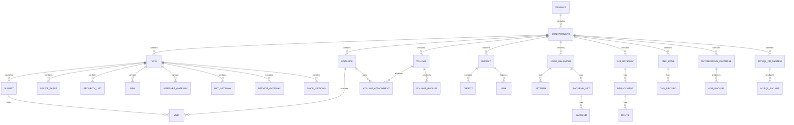
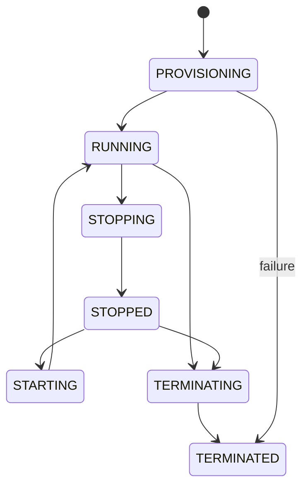
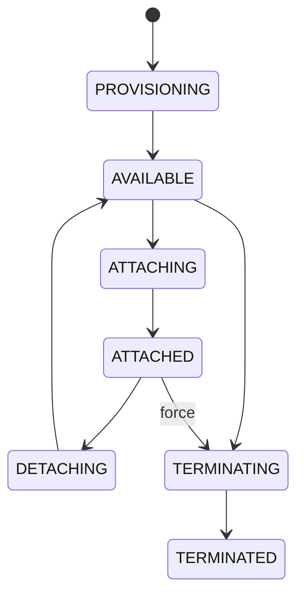
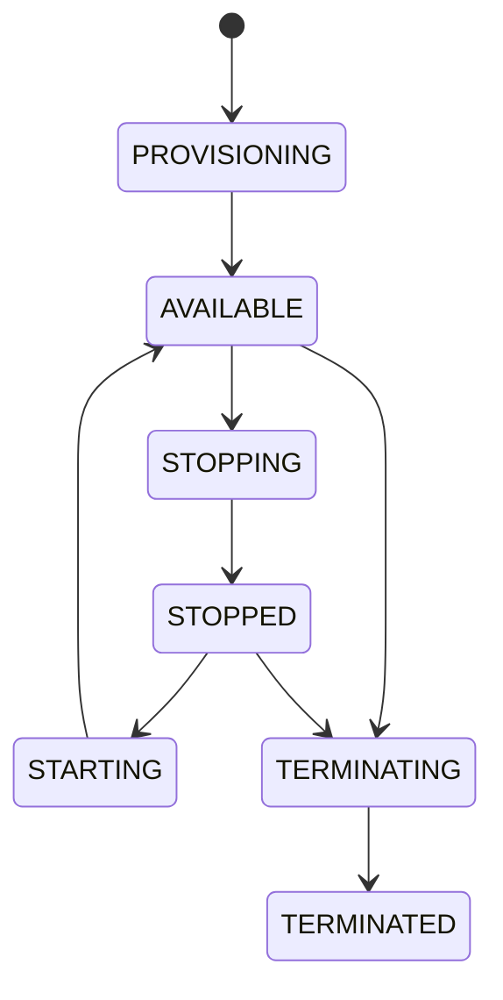
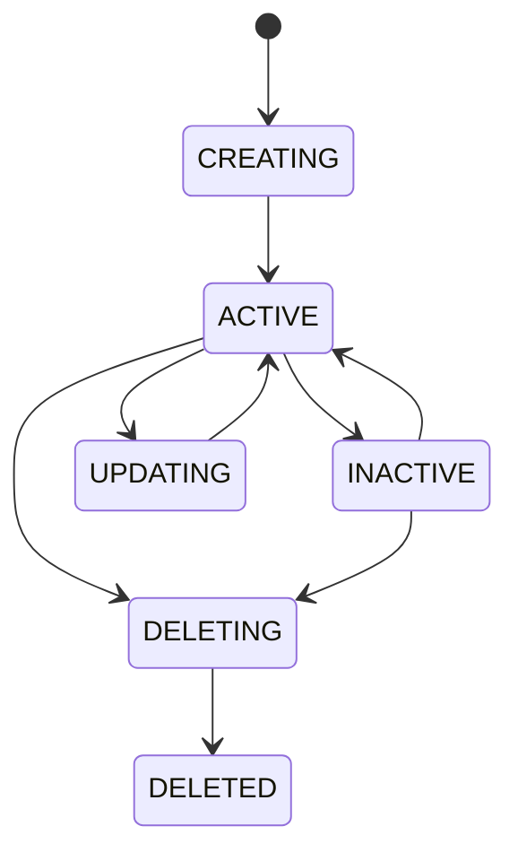

# Data Model

This document defines the resource model, relationships, lifecycle states, and integrity rules for OCI Emulator.

For wire-level rules, see [PROTOCOL.md](PROTOCOL.md). For scope, see [COMPATIBILITY.md](COMPATIBILITY.md).

---

## 1. Conventions

- All resources have an OCID.
- All resources except tenancy-level identity resources have a `compartmentId`.
- All resources have `definedTags` and `freeformTags`.
- Timestamps are ISO 8601 UTC strings.
- Lifecycle states are uppercase strings.
- Storage keys are scoped by tenancy and region.
- Deleted resources are removed from list results. Some services keep a terminal state for work request history.
- The emulator accepts OCIDs with the expected resource type but does not require them to encode a region.

---

## 2. Entity relationships



---

## 3. Shared fields

Most resources share these fields:

```json
{
  "id": "ocid1.<type>.oc1..<unique>",
  "compartmentId": "ocid1.compartment.oc1..demo",
  "displayName": "example",
  "lifecycleState": "ACTIVE",
  "definedTags": {},
  "freeformTags": {},
  "timeCreated": "2026-11-16T18:00:00Z"
}
```

Some resources add:

- `lifecycleDetails`
- `timeUpdated`
- `systemTags`
- `availabilityDomain`
- `region`

---

## 4. Identity

### 4.1 Tenancy

The local tenancy is seeded on first start.

| Field        | Value                         |
| ------------ | ----------------------------- |
| `id`         | `ocid1.tenancy.oc1..emulator` |
| `name`       | `ociemu`                      |
| `homeRegion` | `us-ashburn-1`                |

The tenancy cannot be deleted.

### 4.2 Compartment

| Field            | Type    | Notes                           |
| ---------------- | ------- | ------------------------------- |
| `id`             | string  | OCID                            |
| `compartmentId`  | string  | Parent compartment              |
| `name`           | string  | Unique within the parent        |
| `description`    | string  | Required                        |
| `lifecycleState` | string  | `ACTIVE`, `DELETING`, `DELETED` |
| `timeCreated`    | string  |                                 |
| `timeUpdated`    | string  |                                 |
| `isAccessible`   | boolean | Always true locally             |

Rules:

- The root compartment is the tenancy OCID.
- A compartment cannot be its own parent.
- A compartment cannot be deleted while it has children or resources.
- Deleting a compartment reports the blocking services.

### 4.3 User

| Field            | Type   | Notes                           |
| ---------------- | ------ | ------------------------------- |
| `id`             | string | OCID                            |
| `compartmentId`  | string | Tenancy OCID                    |
| `name`           | string | Login name                      |
| `description`    | string |                                 |
| `email`          | string | Simulated                       |
| `lifecycleState` | string | `ACTIVE`, `INACTIVE`, `DELETED` |
| `timeCreated`    | string |                                 |

### 4.4 Group and membership

| Field            | Type   | Notes               |
| ---------------- | ------ | ------------------- |
| `id`             | string | Group OCID          |
| `compartmentId`  | string | Tenancy OCID        |
| `name`           | string | Unique              |
| `description`    | string |                     |
| `lifecycleState` | string | `ACTIVE`, `DELETED` |
| `members`        | array  | User OCIDs          |

Membership is stored as a relation. Removing a user from a group does not delete the user.

### 4.5 Policy

| Field            | Type             | Notes                 |
| ---------------- | ---------------- | --------------------- |
| `id`             | string           | OCID                  |
| `compartmentId`  | string           | Scope                 |
| `name`           | string           | Unique in compartment |
| `description`    | string           |                       |
| `statements`     | array of strings | Stored, not evaluated |
| `versionDate`    | string           |                       |
| `lifecycleState` | string           | `ACTIVE`, `DELETED`   |

Policies are display-only. There is no authorization evaluation.

### 4.6 Dynamic group

| Field            | Type   | Notes               |
| ---------------- | ------ | ------------------- |
| `id`             | string | OCID                |
| `compartmentId`  | string | Tenancy OCID        |
| `name`           | string | Unique              |
| `description`    | string |                     |
| `matchingRule`   | string | Stored              |
| `lifecycleState` | string | `ACTIVE`, `DELETED` |

---

## 5. Networking

### 5.1 VCN

| Field                   | Type   | Notes                                                    |
| ----------------------- | ------ | -------------------------------------------------------- |
| `id`                    | string | OCID                                                     |
| `compartmentId`         | string |                                                          |
| `displayName`           | string |                                                          |
| `cidrBlock`             | string | Primary IPv4 CIDR                                        |
| `cidrBlocks`            | array  | All IPv4 CIDRs, including `cidrBlock` as the first entry |
| `defaultRouteTableId`   | string |                                                          |
| `defaultSecurityListId` | string |                                                          |
| `defaultDhcpOptionsId`  | string |                                                          |
| `lifecycleState`        | string | `PROVISIONING`, `AVAILABLE`, `TERMINATING`, `TERMINATED` |
| `timeCreated`           | string |                                                          |

Rules:

- CIDR blocks must be valid IPv4.
- CIDR blocks cannot overlap with another VCN in the same compartment.
- A VCN cannot be deleted while it has subnets or gateways.
- Default route table, security list, and DHCP options are created with the VCN.

### 5.2 Subnet

| Field                    | Type    | Notes                                                    |
| ------------------------ | ------- | -------------------------------------------------------- |
| `id`                     | string  | OCID                                                     |
| `compartmentId`          | string  |                                                          |
| `vcnId`                  | string  | Required                                                 |
| `displayName`            | string  |                                                          |
| `cidrBlock`              | string  | IPv4                                                     |
| `routeTableId`           | string  | Must belong to the VCN                                   |
| `securityListIds`        | array   | Must belong to the VCN                                   |
| `dhcpOptionsId`          | string  | Must belong to the VCN                                   |
| `prohibitPublicIpOnVnic` | boolean |                                                          |
| `lifecycleState`         | string  | `PROVISIONING`, `AVAILABLE`, `TERMINATING`, `TERMINATED` |

Rules:

- The subnet CIDR must be inside the VCN CIDR.
- The subnet CIDR cannot overlap with another subnet in the VCN.
- The subnet cannot be deleted while it has VNICs.
- Referenced route tables, security lists, and DHCP options must belong to the same VCN.

### 5.3 Internet gateway

| Field            | Type    | Notes                                                    |
| ---------------- | ------- | -------------------------------------------------------- |
| `id`             | string  | OCID                                                     |
| `compartmentId`  | string  |                                                          |
| `vcnId`          | string  | Required                                                 |
| `displayName`    | string  |                                                          |
| `isEnabled`      | boolean |                                                          |
| `lifecycleState` | string  | `PROVISIONING`, `AVAILABLE`, `TERMINATING`, `TERMINATED` |

### 5.4 NAT gateway

| Field            | Type    | Notes                    |
| ---------------- | ------- | ------------------------ |
| `id`             | string  | OCID                     |
| `compartmentId`  | string  |                          |
| `vcnId`          | string  | Required                 |
| `displayName`    | string  |                          |
| `blockTraffic`   | boolean |                          |
| `lifecycleState` | string  | Same as internet gateway |

### 5.5 Service gateway

| Field            | Type   | Notes                    |
| ---------------- | ------ | ------------------------ |
| `id`             | string | OCID                     |
| `compartmentId`  | string |                          |
| `vcnId`          | string | Required                 |
| `displayName`    | string |                          |
| `services`       | array  | Simulated service OCIDs  |
| `lifecycleState` | string | Same as internet gateway |

### 5.6 Route table

| Field            | Type   | Notes                                                              |
| ---------------- | ------ | ------------------------------------------------------------------ |
| `id`             | string | OCID                                                               |
| `compartmentId`  | string |                                                                    |
| `vcnId`          | string | Required                                                           |
| `displayName`    | string |                                                                    |
| `routeRules`     | array  | `destination`, `destinationType`, `networkEntityId`, `description` |
| `lifecycleState` | string | `PROVISIONING`, `AVAILABLE`, `TERMINATING`, `TERMINATED`           |

Rules:

- A default route table cannot be deleted.
- A route rule destination must be a valid CIDR or service.
- A route rule target must reference an existing gateway, NAT gateway, service gateway, or local peering gateway.

### 5.7 Security list

| Field                  | Type   | Notes                                                                                        |
| ---------------------- | ------ | -------------------------------------------------------------------------------------------- |
| `id`                   | string | OCID                                                                                         |
| `compartmentId`        | string |                                                                                              |
| `vcnId`                | string | Required                                                                                     |
| `displayName`          | string |                                                                                              |
| `ingressSecurityRules` | array  | `protocol`, `source`, `sourceType`, `tcpOptions`, `udpOptions`, `icmpOptions`, `description` |
| `egressSecurityRules`  | array  | Similar with `destination`                                                                   |
| `lifecycleState`       | string | Same as route table                                                                          |

Rules:

- The default security list cannot be deleted.
- Protocol is `all`, `6` (TCP), `17` (UDP), or `1` (ICMP).
- Port ranges are validated.

### 5.8 Network security group

| Field            | Type   | Notes                                                    |
| ---------------- | ------ | -------------------------------------------------------- |
| `id`             | string | OCID                                                     |
| `compartmentId`  | string |                                                          |
| `vcnId`          | string | Required                                                 |
| `displayName`    | string |                                                          |
| `lifecycleState` | string | `PROVISIONING`, `AVAILABLE`, `TERMINATING`, `TERMINATED` |

NSG rules are stored as separate security rules with `nsgId`.

### 5.9 DHCP options

| Field            | Type   | Notes                    |
| ---------------- | ------ | ------------------------ |
| `id`             | string | OCID                     |
| `compartmentId`  | string |                          |
| `vcnId`          | string | Required                 |
| `displayName`    | string |                          |
| `options`        | array  | DNS type and server type |
| `lifecycleState` | string | Same as route table      |

The default DHCP options cannot be deleted.

### 5.10 Private IP

| Field            | Type    | Notes                                 |
| ---------------- | ------- | ------------------------------------- |
| `id`             | string  | OCID                                  |
| `subnetId`       | string  |                                       |
| `vnicId`         | string  | Optional                              |
| `ipAddress`      | string  | IPv4                                  |
| `isPrimary`      | boolean |                                       |
| `lifecycleState` | string  | `AVAILABLE`, `ASSIGNED`, `TERMINATED` |

### 5.11 Public IP

| Field            | Type   | Notes                                                |
| ---------------- | ------ | ---------------------------------------------------- |
| `id`             | string | OCID                                                 |
| `compartmentId`  | string |                                                      |
| `lifetime`       | string | `RESERVED` or `EPHEMERAL`                            |
| `ipAddress`      | string | Simulated public IPv4                                |
| `lifecycleState` | string | `AVAILABLE`, `ASSIGNED`, `TERMINATING`, `TERMINATED` |

---

## 6. Compute

### 6.1 Shape

Shapes are seeded and read-only.

| Field                        | Type    | Notes                         |
| ---------------------------- | ------- | ----------------------------- |
| `shape`                      | string  | Example `VM.Standard.E4.Flex` |
| `processorDescription`       | string  |                               |
| `ocpuOptions`                | object  | Min, max, default             |
| `memoryOptions`              | object  | Min, max, default             |
| `networkingBandwidthOptions` | object  |                               |
| `isFlexible`                 | boolean |                               |

### 6.2 Image

| Field                    | Type   | Notes       |
| ------------------------ | ------ | ----------- |
| `id`                     | string | OCID        |
| `compartmentId`          | string |             |
| `displayName`            | string |             |
| `operatingSystem`        | string |             |
| `operatingSystemVersion` | string |             |
| `lifecycleState`         | string | `AVAILABLE` |
| `timeCreated`            | string |             |

Images are seeded and read-only.

### 6.3 Instance

| Field                | Type    | Notes                                                              |
| -------------------- | ------- | ------------------------------------------------------------------ |
| `id`                 | string  | OCID                                                               |
| `compartmentId`      | string  |                                                                    |
| `availabilityDomain` | string  | `AD-1`, `AD-2`, `AD-3`                                             |
| `displayName`        | string  |                                                                    |
| `shape`              | string  |                                                                    |
| `shapeConfig`        | object  | `ocpus`, `memoryInGBs`                                             |
| `imageId`            | string  |                                                                    |
| `hostnameLabel`      | string  | Request only; defaults to a generated label                        |
| `assignPublicIp`     | boolean | Request only; assigns an ephemeral public IP                       |
| `subnetId`           | string  |                                                                    |
| `privateIp`          | string  | Derived from the primary VNIC; not returned on the instance object |
| `publicIp`           | string  | Derived from the primary VNIC; optional                            |
| `region`             | string  | Region of the instance                                             |
| `lifecycleState`     | string  | See state machine                                                  |
| `timeCreated`        | string  |                                                                    |

State machine:



Actions:

- `START` is valid from `STOPPED`.
- `STOP` is valid from `RUNNING`.
- `REBOOT` is valid from `RUNNING`.
- `RESET` is valid from `RUNNING`.
- `TERMINATE` is valid from `RUNNING`, `STOPPED`, or `PROVISIONING`.

### 6.4 VNIC

| Field            | Type    | Notes                               |
| ---------------- | ------- | ----------------------------------- |
| `id`             | string  | OCID                                |
| `compartmentId`  | string  |                                     |
| `instanceId`     | string  |                                     |
| `subnetId`       | string  |                                     |
| `privateIp`      | string  |                                     |
| `publicIp`       | string  | Optional                            |
| `macAddress`     | string  | Simulated                           |
| `isPrimary`      | boolean |                                     |
| `lifecycleState` | string  | `AVAILABLE`, `ATTACHED`, `DETACHED` |

### 6.5 Console history

| Field         | Type   | Notes                   |
| ------------- | ------ | ----------------------- |
| `id`          | string | OCID                    |
| `instanceId`  | string |                         |
| `displayName` | string |                         |
| `timeCreated` | string |                         |
| `content`     | string | Simulated serial output |

---

## 7. Block Storage

### 7.1 Volume

| Field                | Type    | Notes             |
| -------------------- | ------- | ----------------- |
| `id`                 | string  | OCID              |
| `compartmentId`      | string  |                   |
| `availabilityDomain` | string  |                   |
| `displayName`        | string  |                   |
| `sizeInGBs`          | integer | 50 to 32768       |
| `lifecycleState`     | string  | See state machine |
| `timeCreated`        | string  |                   |

State machine:



Rules:

- A volume cannot be deleted while attached unless force is used.
- Resizing is allowed only in `AVAILABLE` or `ATTACHED`.
- Size cannot be decreased.

### 7.2 Volume attachment

| Field            | Type   | Notes                                            |
| ---------------- | ------ | ------------------------------------------------ |
| `id`             | string | OCID                                             |
| `compartmentId`  | string |                                                  |
| `instanceId`     | string |                                                  |
| `volumeId`       | string |                                                  |
| `device`         | string | `/dev/oracleoci/oraclevdb`                       |
| `attachmentType` | string | `paravirtualized` or `iscsi`                     |
| `lifecycleState` | string | `ATTACHING`, `ATTACHED`, `DETACHING`, `DETACHED` |

Only one attachment per volume at a time.

### 7.3 Volume backup

| Field            | Type    | Notes                                                |
| ---------------- | ------- | ---------------------------------------------------- |
| `id`             | string  | OCID                                                 |
| `compartmentId`  | string  |                                                      |
| `volumeId`       | string  |                                                      |
| `displayName`    | string  |                                                      |
| `sizeInGBs`      | integer |                                                      |
| `lifecycleState` | string  | `CREATING`, `AVAILABLE`, `TERMINATING`, `TERMINATED` |
| `timeCreated`    | string  |                                                      |

---

## 8. Object Storage

### 8.1 Bucket

| Field                 | Type    | Notes                                                   |
| --------------------- | ------- | ------------------------------------------------------- |
| `name`                | string  | Unique in namespace; 1 to 256 characters                |
| `namespace`           | string  | Local namespace                                         |
| `compartmentId`       | string  |                                                         |
| `createdBy`           | string  | User OCID that created the bucket                       |
| `etag`                | string  | Bucket version marker                                   |
| `publicAccessType`    | string  | `NoPublicAccess`, `ObjectRead`, `ObjectReadWithoutList` |
| `objectEventsEnabled` | boolean | Stored and returned; no events are emitted              |
| `storageTier`         | string  | `Standard`                                              |
| `versioning`          | string  | `Disabled` in v1                                        |
| `lifecycleState`      | string  | `ACTIVE`, `DELETING`, `DELETED`                         |
| `timeCreated`         | string  |                                                         |

Rules:

- Bucket names are 1 to 256 characters and use lowercase letters, numbers, periods, hyphens, and underscores.
- Bucket names start and end with a letter or a number.
- Bucket names are globally unique within the local namespace.
- A bucket cannot be deleted while it contains objects.
- Object names may contain slashes and emulate folders.

### 8.2 Object

| Field         | Type    | Notes        |
| ------------- | ------- | ------------ |
| `name`        | string  | Object key   |
| `bucketName`  | string  |              |
| `namespace`   | string  |              |
| `size`        | integer | Bytes        |
| `contentType` | string  |              |
| `etag`        | string  |              |
| `timeCreated` | string  |              |
| `metadata`    | object  | `opc-meta-*` |
| `storageTier` | string  | `Standard`   |

Object bytes are stored by the object storage backend.

### 8.3 Pre-authenticated request

| Field            | Type   | Notes                                            |
| ---------------- | ------ | ------------------------------------------------ |
| `id`             | string | OCID                                             |
| `compartmentId`  | string |                                                  |
| `bucketName`     | string |                                                  |
| `objectName`     | string | Optional                                         |
| `accessType`     | string | `ObjectRead`, `ObjectReadWrite`, `AnyObjectRead` |
| `timeExpires`    | string |                                                  |
| `lifecycleState` | string | `ACTIVE`, `EXPIRED`, `REVOKED`                   |
| `accessUri`      | string | Local URL                                        |

### 8.4 Lifecycle policy

| Field        | Type    | Notes               |
| ------------ | ------- | ------------------- |
| `id`         | string  | OCID                |
| `bucketName` | string  |                     |
| `name`       | string  |                     |
| `action`     | string  | `DELETE`, `ARCHIVE` |
| `timeAmount` | integer | Days                |
| `timeUnit`   | string  | `DAYS`              |
| `isEnabled`  | boolean |                     |

Lifecycle policies are stored and displayed. They are not executed automatically in version 1.

---

## 9. Load Balancer

### 9.1 Load balancer

| Field            | Type   | Notes                                                             |
| ---------------- | ------ | ----------------------------------------------------------------- |
| `id`             | string | OCID                                                              |
| `compartmentId`  | string |                                                                   |
| `displayName`    | string |                                                                   |
| `shapeName`      | string | `flexible`                                                        |
| `subnetIds`      | array  | One or two subnets                                                |
| `lifecycleState` | string | `CREATING`, `ACTIVE`, `UPDATING`, `DELETING`, `DELETED`, `FAILED` |
| `timeCreated`    | string |                                                                   |

### 9.2 Listener

| Field                   | Type    | Notes         |
| ----------------------- | ------- | ------------- |
| `name`                  | string  | Unique in LB  |
| `protocol`              | string  | `HTTP`, `TCP` |
| `port`                  | integer |               |
| `defaultBackendSetName` | string  |               |
| `sslConfiguration`      | object  | Optional      |

### 9.3 Backend set

| Field           | Type   | Notes                               |
| --------------- | ------ | ----------------------------------- |
| `name`          | string | Unique in LB                        |
| `policy`        | string | `ROUND_ROBIN`, `LEAST_CONNECTIONS`  |
| `healthChecker` | object | Protocol, port, URL path, intervals |
| `backends`      | array  | Backend references                  |

### 9.4 Backend

| Field          | Type    | Notes                 |
| -------------- | ------- | --------------------- |
| `name`         | string  | Unique in backend set |
| `ipAddress`    | string  |                       |
| `port`         | integer |                       |
| `weight`       | integer |                       |
| `healthStatus` | string  | Simulated             |

---

## 10. API Gateway

### 10.1 Gateway

| Field            | Type   | Notes                                                             |
| ---------------- | ------ | ----------------------------------------------------------------- |
| `id`             | string | OCID                                                              |
| `compartmentId`  | string |                                                                   |
| `displayName`    | string |                                                                   |
| `subnetId`       | string |                                                                   |
| `endpointType`   | string | `PUBLIC`                                                          |
| `hostname`       | string | Simulated                                                         |
| `lifecycleState` | string | `CREATING`, `ACTIVE`, `UPDATING`, `DELETING`, `DELETED`, `FAILED` |

### 10.2 Deployment

| Field            | Type   | Notes                                                             |
| ---------------- | ------ | ----------------------------------------------------------------- |
| `id`             | string | OCID                                                              |
| `gatewayId`      | string |                                                                   |
| `displayName`    | string |                                                                   |
| `pathPrefix`     | string |                                                                   |
| `specification`  | object | Routes and logging                                                |
| `lifecycleState` | string | `CREATING`, `ACTIVE`, `UPDATING`, `DELETING`, `DELETED`, `FAILED` |

### 10.3 Route

| Field     | Type   | Notes                   |
| --------- | ------ | ----------------------- |
| `path`    | string |                         |
| `methods` | array  | HTTP methods            |
| `backend` | object | Type, URL, and settings |

---

## 11. DNS

### 11.1 Zone

| Field            | Type   | Notes                           |
| ---------------- | ------ | ------------------------------- |
| `id`             | string | OCID                            |
| `compartmentId`  | string |                                 |
| `name`           | string | Zone name                       |
| `zoneType`       | string | `PRIMARY`                       |
| `lifecycleState` | string | `ACTIVE`, `DELETING`, `DELETED` |
| `timeCreated`    | string |                                 |

### 11.2 Record

| Field          | Type    | Notes                                   |
| -------------- | ------- | --------------------------------------- |
| `id`           | string  | OCID                                    |
| `zoneNameOrId` | string  |                                         |
| `domain`       | string  | FQDN                                    |
| `rtype`        | string  | `A`, `AAAA`, `CNAME`, `TXT`, `MX`, `NS` |
| `rdata`        | string  |                                         |
| `ttl`          | integer |                                         |
| `isProtected`  | boolean |                                         |

DNS records are metadata. There is no resolver. `AAAA` records are stored as metadata even though IPv6 networking is out of scope.

---

## 12. Databases

The Autonomous Database and MySQL services share these credential rules:

- Passwords are 12 to 30 characters.
- Passwords contain at least one uppercase letter, one lowercase letter, one digit, and one special character from `!@#$%^&*()-_=+`.
- Passwords do not contain the database name, the display name, or the admin user name.
- Passwords are never returned by the API.
- The emulator stores only a non-reversible marker, not the password.

A violation returns `InvalidParameter` with a message that names the failed rule. See [PROTOCOL.md](PROTOCOL.md) for the error envelope.

### 12.1 Autonomous Database

| Field                  | Type    | Notes             |
| ---------------------- | ------- | ----------------- |
| `id`                   | string  | OCID              |
| `compartmentId`        | string  |                   |
| `dbName`               | string  |                   |
| `displayName`          | string  |                   |
| `cpuCoreCount`         | integer |                   |
| `dataStorageSizeInTBs` | integer |                   |
| `adminPassword`        | string  | Never returned    |
| `lifecycleState`       | string  | See state machine |
| `timeCreated`          | string  |                   |

Rules:

- `dbName` is 1 to 30 characters, uses uppercase letters and digits only, and starts with a letter.
- `cpuCoreCount` is 1 to 128.
- `dataStorageSizeInTBs` is 1 to 128.
- `adminPassword` follows the database credential rules above.

State machine:



### 12.2 ADB backup

| Field                  | Type   | Notes                                       |
| ---------------------- | ------ | ------------------------------------------- |
| `id`                   | string | OCID                                        |
| `autonomousDatabaseId` | string |                                             |
| `displayName`          | string |                                             |
| `lifecycleState`       | string | `CREATING`, `ACTIVE`, `DELETING`, `DELETED` |
| `timeCreated`          | string |                                             |

### 12.3 MySQL DB system

| Field                  | Type    | Notes             |
| ---------------------- | ------- | ----------------- |
| `id`                   | string  | OCID              |
| `compartmentId`        | string  |                   |
| `displayName`          | string  |                   |
| `shapeName`            | string  |                   |
| `subnetId`             | string  |                   |
| `dataStorageSizeInGBs` | integer |                   |
| `adminUsername`        | string  |                   |
| `adminPassword`        | string  | Never returned    |
| `lifecycleState`       | string  | See state machine |
| `timeCreated`          | string  |                   |

Rules:

- `adminUsername` is 1 to 32 characters and uses letters, digits, and underscores.
- `dataStorageSizeInGBs` is 50 to 32768.
- `adminPassword` follows the database credential rules above.

State machine:



### 12.4 MySQL backup

| Field            | Type   | Notes                                       |
| ---------------- | ------ | ------------------------------------------- |
| `id`             | string | OCID                                        |
| `dbSystemId`     | string |                                             |
| `displayName`    | string |                                             |
| `lifecycleState` | string | `CREATING`, `ACTIVE`, `DELETING`, `DELETED` |
| `timeCreated`    | string |                                             |

---

## 13. Work requests

| Field             | Type    | Notes                                                                     |
| ----------------- | ------- | ------------------------------------------------------------------------- |
| `id`              | string  | OCID                                                                      |
| `compartmentId`   | string  |                                                                           |
| `operationType`   | string  | Example `CREATE_VCN`                                                      |
| `status`          | string  | `ACCEPTED`, `IN_PROGRESS`, `SUCCEEDED`, `FAILED`, `CANCELING`, `CANCELED` |
| `percentComplete` | integer | 0 to 100                                                                  |
| `timeAccepted`    | string  |                                                                           |
| `timeStarted`     | string  |                                                                           |
| `timeFinished`    | string  |                                                                           |
| `resources`       | array   | Affected resources                                                        |
| `logs`            | array   | Work request log entries                                                  |
| `errors`          | array   | Work request errors                                                       |

---

## 14. Delete constraints

| Resource            | Blocked by                                                                                                  |
| ------------------- | ----------------------------------------------------------------------------------------------------------- |
| Compartment         | Child compartments, VCNs, instances, volumes, buckets, LBs, API Gateways, DNS zones, ADBs, MySQL DB systems |
| VCN                 | Subnets, gateways, route tables, security lists, NSGs, DHCP options                                         |
| Subnet              | VNICs                                                                                                       |
| Volume              | Attachments, backups                                                                                        |
| Bucket              | Objects                                                                                                     |
| DNS zone            | None                                                                                                        |
| Load balancer       | None                                                                                                        |
| API Gateway         | Deployments                                                                                                 |
| Autonomous Database | Backups in progress                                                                                         |
| MySQL DB system     | Backups in progress                                                                                         |

Deletion returns `Conflict` with a message that names the blocking resource type.

---

## 15. Storage keys

The storage backend scopes resources by tenancy and region.

```text
<tenancyId>/<region>/<service>/<resourceType>/<ocid>.json
<tenancyId>/<region>/object-storage/<namespace>/<bucket>/<object-key>
```

The exact internal layout is owned by the floci storage backend. Services must use the abstraction, not filesystem paths.

Object keys are stored as bytes with metadata. The metadata JSON does not contain the object body.

---

## 16. Seed data

`make seed` creates:

- Root compartment plus `demo` and `sandbox` compartments.
- A VCN `demo-vcn` with CIDR `10.0.0.0/16`.
- A public subnet `10.0.1.0/24`.
- An internet gateway and a route table.
- A security list with SSH and HTTP rules.
- One running instance.
- One 50 GB block volume attached to the instance.
- A bucket `demo-bucket` with two sample objects.
- A load balancer with one listener and one backend set.
- An API Gateway with one deployment.
- A DNS zone `example.local` with two records.
- An Autonomous Database `DEMOADB`.
- A MySQL DB system `demo-mysql`.
- IAM users, groups, and a policy.
- One completed work request per asynchronous operation.

Seed data is deterministic. Running seed twice resets first or fails with a clear message; the implementation must choose one behavior and document it. The default is reset then seed.

---

## 17. Naming rules

- Display names are 1 to 255 characters.
- Names may contain letters, numbers, spaces, hyphens, underscores, and periods.
- Bucket names use lowercase letters, numbers, hyphens, and periods.
- DNS zone names use lowercase letters, numbers, hyphens, and periods.
- OCIDs are generated, never user-provided.
- Names are not unique unless the service requires it.

---

## 18. Time and ordering

- All timestamps are UTC.
- List results are sorted by `timeCreated` descending by default.
- `sortBy` and `sortOrder` are supported where documented.
- Relative times in the UI are derived from the absolute timestamp.
- Work request timestamps are monotonic.
